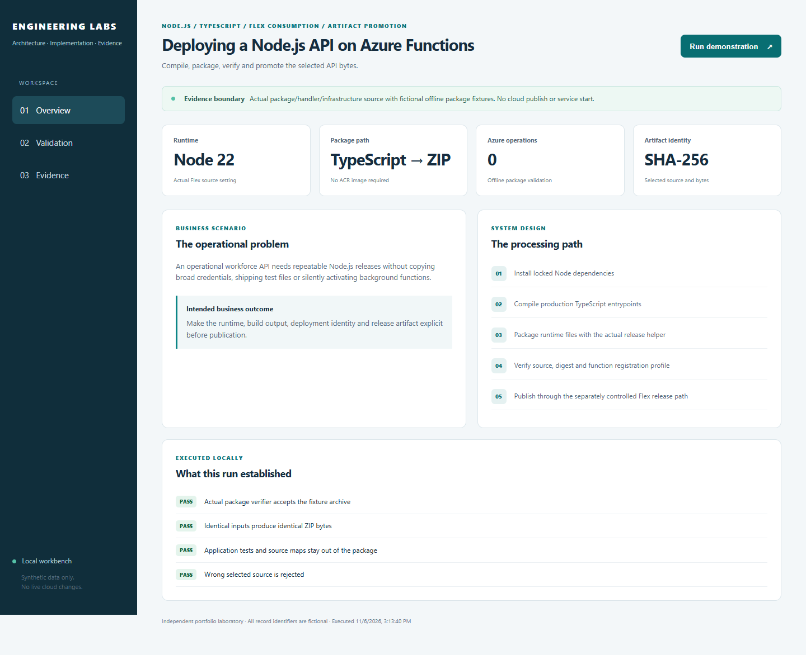
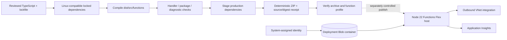
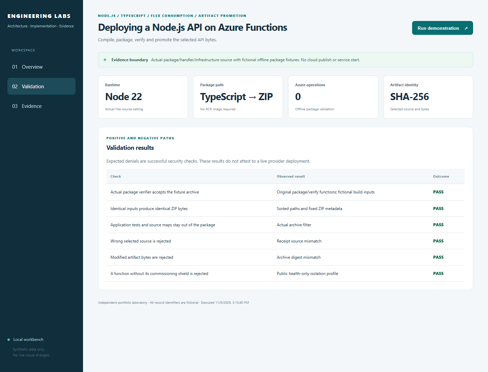

# Deploying a Node.js API on Azure Functions

**Package and release the server code that was tested, without rebuilding it at the last minute.**

[The problem](#the-business-problem) · [The solution](#the-solution) · [What was built](#what-was-built) · [Proof it works](#proof-it-works) · [Commands](docs/COMMANDS.md) · [Step by step](#step-by-step)



## The Business Problem

The backend accepts applications, records employee work and supports payroll-related administration. A release containing missing packages, outdated compiled code or the wrong configuration can interrupt several teams at once. A successful build on an engineer's computer gives limited assurance about how the package will run on the Linux host.

Publishing code also shares an environment with email senders, signing controls and background processes. Accidentally changing those settings can trigger work outside the intended release. If the package is rebuilt between testing and production, diagnosing a failure becomes harder because the released files may differ from the ones that passed.

The business need was to package and verify a complete server release once, promote the selected files and preserve unrelated operating settings during deployment.

## The Solution

Build the Node.js server, package the files it needs, and check the package before publishing it to Azure Functions. Keep a fingerprint of the tested file and use that same file for the release. Treat turning on email, signing or background work as a separate setting.

**Business outcome:** Make releases easier to trace and reduce the chance that publishing code changes unrelated operating settings.

### Actual platform implementation

This project includes the platform's real health handler, host/TypeScript configuration, package/verification functions, ZIP diagnostic logic and Flex host Terraform. Private identifiers and the full business API are excluded. The minimal sample contains only the public health endpoint; it is not an employee/Payroll API clone.

The platform implementation uses locked Node dependencies, production TypeScript compilation and development-dependency pruning. Its API host uses system-assigned identity for deployment-container access, outbound VNet integration, HTTPS and disabled basic publishing authentication. The reviewed environment root owns activation/settings and the publisher owns actual release execution.

The standalone example defaults to a Disabled host, contains no Azure publishing client and has a manual-only validation workflow. [Actual source/adaptations](docs/SOURCE-MAP.md) · [Evidence boundaries](docs/VALIDATION.md).

## Tools Used and What They Do

| Tool or service | What it does | Where it fits |
| --- | --- | --- |
| Node.js and TypeScript | Run the server and compile its typed source into JavaScript. | Actual API runtime and source language. |
| Azure Functions v4 SDK | Register HTTP and background handlers in code. | Actual programming model; not an Express server. |
| npm | Install the recorded application dependencies and run build commands. | Build/local utility; runtime packaging is checked separately. |
| GitHub Actions and Azure CLI | Coordinate release checks and inspect/manage the selected Azure target. | Actual operating tools; the public workflow has no cloud publisher credentials. |
| Terraform | Describe the selected API host configuration. | Reference host module; identities, grants and private paths need their own setup. |
| Application Insights | Collect runtime diagnostic information. | Actual host configuration; configuration alone does not prove log arrival. |
| Azure Functions Core Tools and Azurite | Offer an optional local Functions host and storage emulator. | Optional preparation only; default tests do not require or prove this host path. |
| Python | Run the packaging workbench and archive checks. | Local/reference utility, not the deployed Node.js API runtime. |

The local handler harness and packaging checks remain separate from a hosted Functions invocation, real sign-in and SQL access.

## Step by Step

Your own JavaScript Azure Function, tested locally and published to a new Function App.

[Open the standalone build guide](docs/BUILD-YOUR-OWN.md) or follow the same complete instructions below.

Start with a new folder, your own files and your own accounts. The numbered steps below describe the build; no portfolio repository checkout is required. The existing implementation/evidence elsewhere in this repository is a separate reference, not a claim that your new build has already passed.

### Prerequisites

Supported Node LTS, Azure Functions Core Tools v4, Azurite for local host storage, Azure CLI, and an Azure subscription with a budget and permission to create a new Function App/storage account.

Use Bash on Linux/macOS/WSL for Bash blocks and PowerShell for PowerShell blocks. Select the tool versions supported by the official sources below, record the versions you actually install and retain generated dependency locks. Cloud resources, scanner downloads, logs and external AI calls can create costs; review the stated scope before enabling them.

### Create your project folder

Choose a new folder name. These first commands create a blank project; an optional `git init` gives it its own history. Create parent directories in your editor when a later step introduces a nested file.

```bash
mkdir my-azure-nodejs-api-deployment
cd my-azure-nodejs-api-deployment
git init
```

Create `.gitignore` before saving credentials or build outputs:

```gitignore
.venv/
node_modules/
.env
.env.*
local.settings.json
credentials.json
token.json
*.pem
*.key
*.tfstate*
*.tfplan
.terraform/
private*/
captures/
backups/
batch.json
reports/
out/
app-config.local.yaml
```

The source/file snippets are a starting implementation you type or paste into the named files. Replace `YOUR_*`, names, regions and addresses only with values from your own lab; do not place real client/employee records in a test project. Keep your terminal in this project root unless a step explicitly changes directory.

Before a first commit, set your own repository-local author with `git config user.name "YOUR_NAME"` and `git config user.email "YOUR_PUBLIC_COMMIT_EMAIL"`. Review `git status --short` and the staged diff before publishing; ignored local files are not a substitute for reviewing what you upload.

### Step 1 — Generate a new Functions project

**Where:** Your empty project folder.

Use Core Tools to generate a JavaScript project and an HTTP-trigger template named health. This generator creates your own app; it does not check out the portfolio repository.

```bash
func init . --worker-runtime node --language javascript
func new --template "HTTP trigger" --name health --authlevel anonymous
```

**Check before continuing:** The folder contains host.json, package.json and a health function file.

### Step 2 — Write the health handler

**Where:** The generated function file under src/functions.

Replace the generated HTTP function with the code below and confirm package.json main includes that directory. Keep the response limited to service health; never expose environment variables, tokens or database strings. Explicitly select CommonJS for the require-based handler and retain the generated package-lock.json.

```bash
npm pkg set type=commonjs 'main=src/functions/*.js'
npm install --save-exact @azure/functions@4
```

Create **`src/functions/health.js`** with the following contents:

```javascript
const { app } = require('@azure/functions');
app.http('health', {
  methods: ['GET'], authLevel: 'anonymous',
  handler: async () => ({jsonBody: {service: 'my-api', status: 'ok'}})
});
```

**Check before continuing:** The function registers GET health through the v4 app model.

### Step 3 — Run your local host

**Where:** Project root, two running-server terminals and a browser or third terminal.

Create the local-only settings below in this new project. Install Azurite in an isolated tooling folder, exclude its files and emulator data from Git and Functions publication, then leave the emulator running in terminal 1. In terminal 2, return to the same project root and start the Functions host; use a browser or terminal 3 for the health request. These Bash commands also work in Git Bash on Windows; use curl.exe if running the request in PowerShell.

Create **`local.settings.json`** with the following contents:

```json
{
  "IsEncrypted": false,
  "Values": {
    "FUNCTIONS_WORKER_RUNTIME": "node",
    "AzureWebJobsStorage": "UseDevelopmentStorage=true"
  }
}
```

```bash
# Terminal 1, from the project root:
mkdir -p .tools/azurite .azurite
npm install --prefix .tools/azurite --save-exact azurite
printf '\n.tools/\n.azurite/\nlocal.settings.json\n' >> .gitignore
printf '\n.tools/\n.azurite/\nlocal.settings.json\n' >> .funcignore
./.tools/azurite/node_modules/.bin/azurite --location .azurite --debug .azurite/debug.log

# Terminal 2, same project root:
func start

# Terminal 3, or open this URL in your browser:
curl -i http://localhost:7071/api/health
```

If a storage port is already occupied, stop your duplicate emulator or use the existing local instance deliberately. If Core Tools prints another HTTP port, request that port. Keep local.settings.json private and out of the published package; configure real host storage separately in Azure.

**Check before continuing:** Azurite is running locally, Core Tools registers health and GET /api/health returns your JSON. Keep both server terminals open during local testing; stop both with Ctrl+C afterward.

### Step 4 — Create the Azure host

**Where:** Azure Portal → Function App → Create.

Create a new Linux Function App using a currently supported Node runtime and hosting plan in your isolated group. Choose its storage account, monitoring workspace and identity deliberately; inspect the estimated plan/storage/log costs and network reachability requirements.

**Check before continuing:** The app exists with the selected runtime and reachable host-storage dependencies.

### Step 5 — Publish the project you created

**Where:** Your project folder.

Select your intended subscription and publish only to the newly named Function App. Confirm that the package excludes local.settings.json and that required app settings are configured on the host.

```bash
az login
az account set --subscription "YOUR_SUBSCRIPTION_ID"
func azure functionapp publish YOUR_FUNCTION_APP_NAME
```

**Check before continuing:** The publish completes and your hosted /api/health route returns the expected JSON.

### Step 6 — Add the identity boundary and verify it

**Where:** Function App → Authentication.

For staff endpoints, configure Microsoft Entra authentication, the correct audience and restricted user/app access before exposing business data. Test both authorized and unauthenticated calls; function keys, Entra identity and employee ownership are different controls.

**Check before continuing:** You have a health check plus separately recorded access tests, not a claim that health proves all APIs work.

### Step 7 — Capture the release and close the lab

**Where:** Your files and Azure Portal.

Record the runtime, package source, deployment outcome, health response and authentication results. Delete only this dedicated lab group after reviewing retained monitoring/storage costs.

**Check before continuing:** Your own app can be rebuilt from its files and deployment notes.

### Verification and your own screenshots

| Evidence | What to record | Your result |
| --- | --- | --- |
| New build | Your own files/resource settings and tool versions | Not yet recorded |
| Working path | The actual successful request, configuration or recovery result | Not yet recorded |
| Failure boundary | A meaningful denied, malformed, stale or failed case | Not yet recorded |
| Recovery / cleanup | What you restored or removed and what remains billed | Not yet recorded |

Capture your own architecture/configuration, one working result and one failure/recovery result. Keep tokens, credentials, personal records and private identifiers out of public screenshots. Existing portfolio images are references, not evidence that you performed these steps.

### Troubleshooting order

1. Confirm the named file, working directory and selected tool/interpreter.
2. Check the exact input and resource/account selected for the failing step.
3. Separate identity permission, network/DNS reachability and application validation.
4. Keep the actual error and reconcile an unknown write outcome before repeating it; do not widen access or repeat paid operations blindly.

The numbered steps describe a build procedure. Local syntax checks, an accepted API request, a completed hosted operation and a human verification are different evidence levels; fill in the verification table with what you actually observed.

### Official implementation references

- [learn.microsoft.com — create-first-function-cli-node](https://learn.microsoft.com/en-us/azure/azure-functions/create-first-function-cli-node)
- [learn.microsoft.com — functions-reference-node](https://learn.microsoft.com/en-us/azure/azure-functions/functions-reference-node)
- [github.com — Azurite](https://github.com/Azure/Azurite)

The walkthrough layout follows the prerequisites → creation/configuration → test → verification → troubleshooting → cleanup pattern of the [Splunk project reference](https://github.com/davidharris6/splunk-siem-log-analysis). Its Splunk-specific settings are not copied into unrelated projects.

<details>
<summary>Reference: how the existing platform implementation operates</summary>

A short walkthrough of the process, with technical instructions and evidence limits in the sections below.

1. **Prepare the server code (TypeScript)** — Select the reviewed version and its recorded software dependencies. Build and test the server functions that belong in the release.

2. **Create the release package (npm and packaging checks)** — Package the required runtime files and check the contents. Save a file fingerprint so the package can be identified later.

3. **Publish the tested package (GitHub Actions)** — The platform release process sends the verified package to Azure Functions. Settings that activate email or background work remain separate from publishing code.

4. **Verify the release** — Check service health and compare the published package with the intended version. This public project tests packaging locally and does not publish a live service.

</details>

## Architecture



This is a Functions package deployment, not an ACR container deployment. A ZIP file is the artifact format; Flex uses its supported package-deployment path rather than every legacy ZIP-deploy option. VNet integration is outbound connectivity, not proof that the HTTP endpoint is private.

## What Was Built

| Component | Purpose | Implementation |
| --- | --- | --- |
| Actual TypeScript health handler | A public health response showing the environment and time | [Source](sample-api/src/functions/health.ts) |
| Actual build/runtime shape | v4 app.http registration, compiled entrypoint glob, host configuration | [Sample API](sample-api/) |
| Actual archive builder/verifier | Stable ZIP metadata, required inputs, filtered tests/maps and commissioning checks | [Source](reference/release_package.py) |
| Original package diagnostic tests | Distinguish repacked ZIP bytes from changed filesystem contents | [Original tests](reference/test_package_diagnostics.py) |
| Local archive command | Create and check a local release record without uploading files or starting services | [Wrapper](scripts/package-local.py) |
| Actual Flex host Terraform | Node 22, managed identity, VNet integration, HTTPS and selected scale limits | [Terraform](infra/) |
| Manual-only workflow | Compile/test, prune dev dependencies and verify the package without publishing | [Workflow](.github/workflows/validate.yml) |

## Proof It Works

**Local validation:** 16 code tests, four direct HTTP checks, six demo assertions and three Terraform tests using simulated cloud responses passed. No cloud deployment.

### 1. Build and invoke the actual handler

```bash
npm ci --prefix sample-api --ignore-scripts --no-audit --no-fund
npm test --prefix sample-api
```

**Look for:** the TypeScript build and three direct-handler tests verify the health contract, environment fallback and timestamp. The SDK reports test mode outside the Functions host; this is expected and is not Functions-host acceptance.

### 2. Reject incomplete or altered packages

```bash
python -B -m unittest discover -s tests -v
python -B -m unittest discover -s reference -v
python -B -m lab demo
```

**Look for:** missing entrypoints, wrong source, modified bytes, dynamic registrations and missing Function shields fail. Application tests/maps are excluded. Six original ZIP diagnostic tests distinguish file/tree changes from compression/repackaging differences.

### 3. Verify the host configuration without creating it

```bash
terraform -chdir=infra init -backend=false -input=false
terraform -chdir=infra validate
terraform -chdir=infra test
```

**Look for:** three tests using simulated cloud responses verify Node 22/default pause, system-assigned deployment identity/HTTPS and outbound network/scale settings. Mock tests do not prove actual role grants, private routes or app startup.

### 4. Visible local evidence



Screenshots come from actual local code using fictional archive inputs. They do not show an Azure deployment. Node build/handler, HTTP-harness and Terraform results are recorded separately in [validation](docs/VALIDATION.md).

## Run It Locally

Use Node 22 and Python 3.12. Two local views serve different purposes:

```bash
# Actual Node health handler through a direct local HTTP harness:
npm ci --prefix sample-api --ignore-scripts --no-audit --no-fund
npm test --prefix sample-api
npm run serve:local --prefix sample-api
```

Open [the local Node health endpoint](http://127.0.0.1:8020/api/health). This harness is not the Azure Functions host. In another terminal:

```bash
# Package/evidence workbench, using fictional compiled fixtures:
python -B -m lab serve --port 8011
```

Open [the packaging workbench](http://127.0.0.1:8011). On PowerShell, use npm.cmd if required. Ctrl+C stops each process. [Full commands and optional Core Tools setup](docs/COMMANDS.md).

## Deployment Process

1. Select reviewed source and its lockfile; build dependencies for the target Linux runtime/architecture.
2. Compile and test; stage production dependencies, required migration/template assets and configuration without private secrets.
3. Create the archive/receipt and verify entrypoints, path safety, source/digest and the explicit Function commissioning profile.
4. Publish to nonproduction through the supported Flex deployment path, verify the actual runtime and restore the environment's original power/settings state.
5. Save and check the verified release package, then publish that same package to production. Do not rebuild during promotion.
6. Verify health, protected routes and downstream compatibility separately. A public health 200 is not a SQL/Blob/Entra authorization test.

This repository supplies the build/validation reference, not a live cloud publisher. The real platform's ordinary publisher and exact-release authorization remain outside this public sample. [Pipeline and deployment guide](docs/DEPLOYMENT.md).

## Security Practices

- The sample health endpoint is intentionally anonymous and contains no employee data. Business routes require separate token, role and permission checks for the specific record.
- CORS restricts browser-origin behavior; it does not authenticate a caller. Outbound VNet integration does not make inbound HTTP private.
- Deployment identity, runtime identity and privileged directory-worker authority have separate responsibilities and grants.
- A source SHA in a locally generated receipt is a selection label, not independent proof that the build came from a trusted checkout. Trusted CI/archive evidence is still required.
- Do not publish host keys, local settings, connection strings, environment dumps, state or actual employee/form assets.

## Scaling and Tradeoffs

The selected host source specifies up to ten instances and 2048 MiB per instance. Those settings are not guaranteed throughput. Node event-loop behavior, database pools, trigger concurrency, key-service calls and downstream limits all matter. [Strengths, weaknesses, costs and scaling](docs/SCALING.md).

## Troubleshooting Lessons

A healthy HTTP endpoint did not mean background work was healthy. The recorded repair isolated a conflicting storage setting, then verified listeners and executions. [Read the incident, evidence and verification](docs/LESSONS-LEARNED.md).

## Project Guides

| Guide | Purpose |
| --- | --- |
| [Architecture](docs/ARCHITECTURE.md) | Runtime, code/package, identity and network boundaries |
| [Build/package](docs/BUILD-AND-PACKAGE.md) | TypeScript output, lockfiles, production dependencies and ZIP layout |
| [Deployment](docs/DEPLOYMENT.md) | Flex publication, promotion, activation and rollback distinctions |
| [Commands](docs/COMMANDS.md) | Windows/Linux steps and expected results |
| [Source map](docs/SOURCE-MAP.md) | Actual implementation versus new wrappers/fixtures |
| [Terraform](infra/README.md) | Existing host dependencies and missing commissioning work |
| [Troubleshooting](docs/OPERATIONS.md) | Build, Linux dependency, identity, registration and health failures |
| [Validation](docs/VALIDATION.md) | What was executed and what remains outside local acceptance |
| [Scaling](docs/SCALING.md) | Event loop, concurrency, downstream capacity and cost tradeoffs |

## Cost and Cleanup

Local checks start no Azure resource and dispatch no Actions run. Applying the host Terraform can create a billed service and requires separately supplied hosting/storage/network dependencies. No upload workflow is included. The local package output belongs under ignored .release; installed dependencies and compiled dist are excluded from Git.
