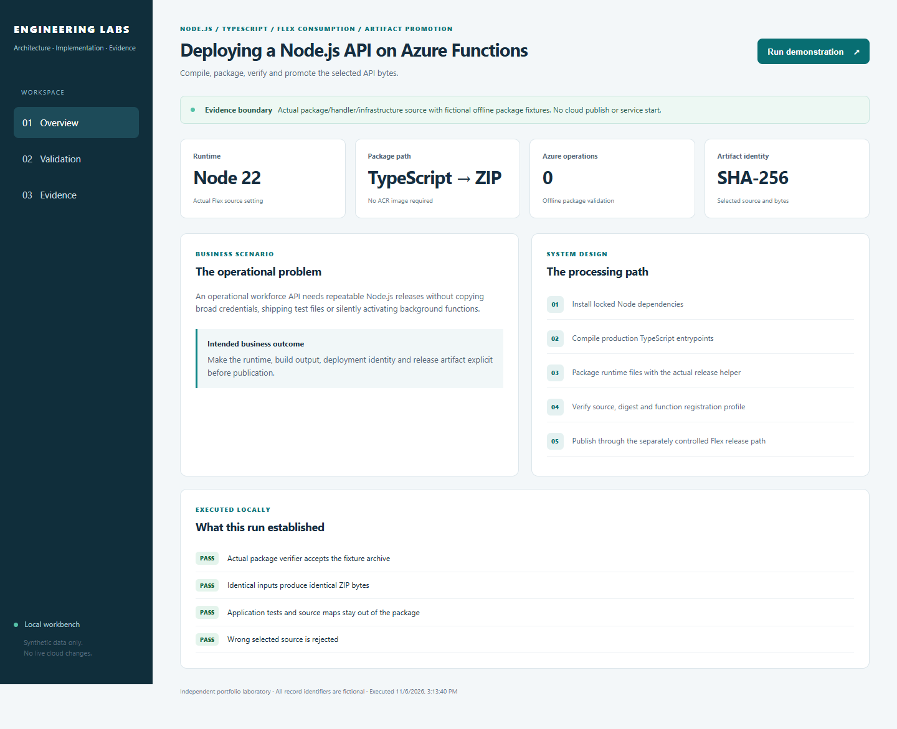
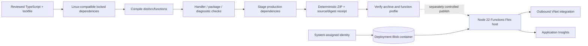
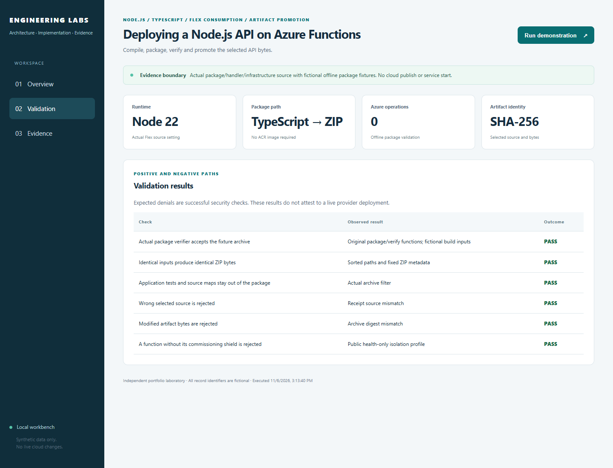

# Deploying a Node.js API on Azure Functions

**Package and release the server code that was tested, without rebuilding it at the last minute.**

[The problem](#the-business-problem) · [The solution](#the-solution) · [What was built](#what-was-built) · [Proof it works](#proof-it-works) · [Commands](docs/COMMANDS.md) · [Step by step](#step-by-step)



## The Business Problem

The platform’s server handles requests for onboarding, payroll and other daily work. Releasing the wrong files, missing required software, or accidentally turning on background jobs can disrupt those processes. A successful build on a Windows computer also does not prove the release will run correctly on Linux.

## The Solution

Build the Node.js server, package the files it needs, and check the package before publishing it to Azure Functions. Keep a fingerprint of the tested file and use that same file for the release. Treat turning on email, signing or background work as a separate setting.

**Business outcome:** Make releases easier to trace and reduce the chance that publishing code changes unrelated operating settings.

### Actual platform implementation

This project includes the platform's real health handler, host/TypeScript configuration, package/verification functions, ZIP diagnostic logic and Flex host Terraform. Private identifiers and the full business API are excluded. The minimal sample contains only the public health endpoint; it is not an employee/Payroll API clone.

The platform implementation uses locked Node dependencies, production TypeScript compilation and development-dependency pruning. Its API host uses system-assigned identity for deployment-container access, outbound VNet integration, HTTPS and disabled basic publishing authentication. The reviewed environment root owns activation/settings and the publisher owns actual release execution.

The standalone example defaults to a Disabled host, contains no Azure publishing client and has a manual-only validation workflow. [Actual source/adaptations](docs/SOURCE-MAP.md) · [Evidence boundaries](docs/VALIDATION.md).

## Step by Step

A short walkthrough of the process, with technical instructions and evidence limits in the sections below.

1. **Prepare the server code** — Select the reviewed version and its recorded software dependencies. Build and test the server functions that belong in the release.

2. **Create the release package** — Package the required runtime files and check the contents. Save a file fingerprint so the package can be identified later.

3. **Publish the tested package** — The platform release process sends the verified package to Azure Functions. Settings that activate email or background work remain separate from publishing code.

4. **Verify the release** — Check service health and compare the published package with the intended version. This public project tests packaging locally and does not publish a live service.

## Architecture



This is a Functions package deployment, not an ACR container deployment. A ZIP file is the artifact format; Flex uses its supported package-deployment path rather than every legacy ZIP-deploy option. VNet integration is outbound connectivity, not proof that the HTTP endpoint is private.

## What Was Built

| Component | Purpose | Implementation |
| --- | --- | --- |
| Actual TypeScript health handler | A public health response showing the environment and time | [Source](sample-api/src/functions/health.ts) |
| Actual build/runtime shape | v4 app.http registration, compiled entrypoint glob, host configuration | [Sample API](sample-api/) |
| Actual archive builder/verifier | Stable ZIP metadata, required inputs, filtered tests/maps and commissioning checks | [Source](reference/release_package.py) |
| Original package diagnostic tests | Distinguish repacked ZIP bytes from changed filesystem contents | [Original tests](reference/test_package_diagnostics.py) |
| Local archive command | Create and check a local release record without uploading files or starting services | [Wrapper](scripts/package-local.py) |
| Actual Flex host Terraform | Node 22, managed identity, VNet integration, HTTPS and selected scale limits | [Terraform](infra/) |
| Manual-only workflow | Compile/test, prune dev dependencies and verify the package without publishing | [Workflow](.github/workflows/validate.yml) |

## Proof It Works

**Local validation:** 16 code tests, four direct HTTP checks, six demo assertions and three Terraform tests using simulated cloud responses passed. No cloud deployment.

### 1. Build and invoke the actual handler

```bash
npm ci --prefix sample-api --ignore-scripts --no-audit --no-fund
npm test --prefix sample-api
```

**Look for:** the TypeScript build and three direct-handler tests verify the health contract, environment fallback and timestamp. The SDK reports test mode outside the Functions host; this is expected and is not Functions-host acceptance.

### 2. Reject incomplete or altered packages

```bash
python -B -m unittest discover -s tests -v
python -B -m unittest discover -s reference -v
python -B -m lab demo
```

**Look for:** missing entrypoints, wrong source, modified bytes, dynamic registrations and missing Function shields fail. Application tests/maps are excluded. Six original ZIP diagnostic tests distinguish file/tree changes from compression/repackaging differences.

### 3. Verify the host configuration without creating it

```bash
terraform -chdir=infra init -backend=false -input=false
terraform -chdir=infra validate
terraform -chdir=infra test
```

**Look for:** three tests using simulated cloud responses verify Node 22/default pause, system-assigned deployment identity/HTTPS and outbound network/scale settings. Mock tests do not prove actual role grants, private routes or app startup.

### 4. Visible local evidence



Screenshots come from actual local code using fictional archive inputs. They do not show an Azure deployment. Node build/handler, HTTP-harness and Terraform results are recorded separately in [validation](docs/VALIDATION.md).

## Run It Locally

Use Node 22 and Python 3.12. Two local views serve different purposes:

```bash
# Actual Node health handler through a direct local HTTP harness:
npm ci --prefix sample-api --ignore-scripts --no-audit --no-fund
npm test --prefix sample-api
npm run serve:local --prefix sample-api
```

Open [the local Node health endpoint](http://127.0.0.1:8020/api/health). This harness is not the Azure Functions host. In another terminal:

```bash
# Package/evidence workbench, using fictional compiled fixtures:
python -B -m lab serve --port 8011
```

Open [the packaging workbench](http://127.0.0.1:8011). On PowerShell, use npm.cmd if required. Ctrl+C stops each process. [Full commands and optional Core Tools setup](docs/COMMANDS.md).

## Deployment Process

1. Select reviewed source and its lockfile; build dependencies for the target Linux runtime/architecture.
2. Compile and test; stage production dependencies, required migration/template assets and configuration without private secrets.
3. Create the archive/receipt and verify entrypoints, path safety, source/digest and the explicit Function commissioning profile.
4. Publish to nonproduction through the supported Flex deployment path, verify the actual runtime and restore the environment's original power/settings state.
5. Save and check the verified release package, then publish that same package to production. Do not rebuild during promotion.
6. Verify health, protected routes and downstream compatibility separately. A public health 200 is not a SQL/Blob/Entra authorization test.

This repository supplies the build/validation reference, not a live cloud publisher. The real platform's ordinary publisher and exact-release authorization remain outside this public sample. [Pipeline and deployment guide](docs/DEPLOYMENT.md).

## Security Practices

- The sample health endpoint is intentionally anonymous and contains no employee data. Business routes require separate token, role and permission checks for the specific record.
- CORS restricts browser-origin behavior; it does not authenticate a caller. Outbound VNet integration does not make inbound HTTP private.
- Deployment identity, runtime identity and privileged directory-worker authority have separate responsibilities and grants.
- A source SHA in a locally generated receipt is a selection label, not independent proof that the build came from a trusted checkout. Trusted CI/archive evidence is still required.
- Do not publish host keys, local settings, connection strings, environment dumps, state or actual employee/form assets.

## Scaling and Tradeoffs

The selected host source specifies up to ten instances and 2048 MiB per instance. Those settings are not guaranteed throughput. Node event-loop behavior, database pools, trigger concurrency, key-service calls and downstream limits all matter. [Strengths, weaknesses, costs and scaling](docs/SCALING.md).

## Troubleshooting Lessons

A healthy HTTP endpoint did not mean background work was healthy. The recorded repair isolated a conflicting storage setting, then verified listeners and executions. [Read the incident, evidence and verification](docs/LESSONS-LEARNED.md).

## Project Guides

| Guide | Purpose |
| --- | --- |
| [Architecture](docs/ARCHITECTURE.md) | Runtime, code/package, identity and network boundaries |
| [Build/package](docs/BUILD-AND-PACKAGE.md) | TypeScript output, lockfiles, production dependencies and ZIP layout |
| [Deployment](docs/DEPLOYMENT.md) | Flex publication, promotion, activation and rollback distinctions |
| [Commands](docs/COMMANDS.md) | Windows/Linux steps and expected results |
| [Source map](docs/SOURCE-MAP.md) | Actual implementation versus new wrappers/fixtures |
| [Terraform](infra/README.md) | Existing host dependencies and missing commissioning work |
| [Troubleshooting](docs/OPERATIONS.md) | Build, Linux dependency, identity, registration and health failures |
| [Validation](docs/VALIDATION.md) | What was executed and what remains outside local acceptance |
| [Scaling](docs/SCALING.md) | Event loop, concurrency, downstream capacity and cost tradeoffs |

## Cost and Cleanup

Local checks start no Azure resource and dispatch no Actions run. Applying the host Terraform can create a billed service and requires separately supplied hosting/storage/network dependencies. No upload workflow is included. The local package output belongs under ignored .release; installed dependencies and compiled dist are excluded from Git.
